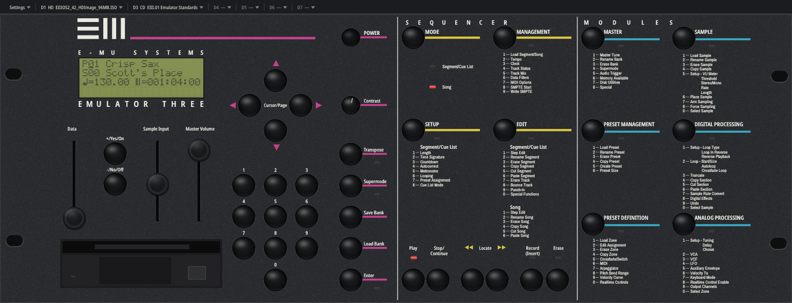
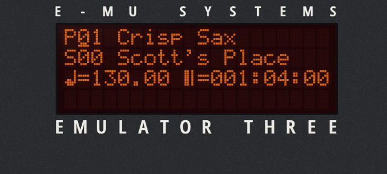
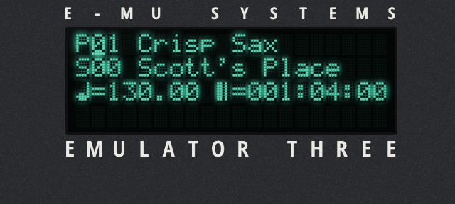
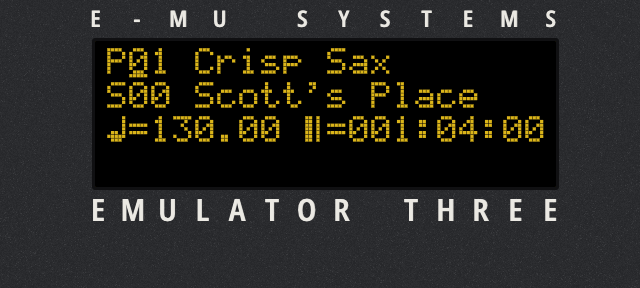
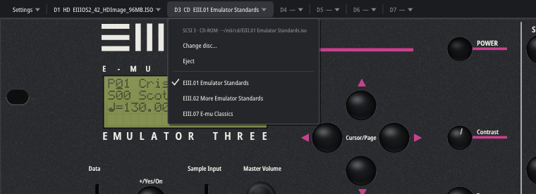

# Emulated-3

**Beta.** Expect rough edges, and please report what you find.

An unofficial emulator of the **E-mu Emulator III** sampler, as **Windows x64 VST3 and standalone**, plus a **Linux CLAP instrument plugin and standalone**. It runs the original EIII boot ROM and **Operating System 2.42** unmodified, from your own disk images.
You operate it from the original rack front panel (the panel is the instrument), MIDI goes to the emulated MIDI IN, and
the voice outputs are rendered through a model of the EIII's F-Chip and CEM3387 filter/VCA hardware.



> **No E-mu material is included.** This repository has no boot ROMs, no operating system, and no sample or bank data.
> To use it you need your own EIII boot ROM dumps, an OS 2.42 hard disk image and, optionally, EIII CD-ROM images.
>
> **[Download the plugin from Releases](https://github.com/Tuth/Emulated-3/releases), then follow
> [INSTALL.md](INSTALL.md)**: where the ROMs, the OS disk and CDs go, first start, and troubleshooting.

## Features

- **The original OS, unmodified.** Boot, Load Bank, the sequencer and the modules all run the EIII's own code. The CPU,
  SCSI, MIDI and front-panel hardware are checked against MAME's behaviour by a regression suite (`make check`).
- **Front panel GUI.** Vector artwork at any size. Mouse-down/up on a button is the switch's make/break, and the sliders
  drive the ADC inputs. The 4 × 20 LCD and the 17 LEDs show the machine's own state.
- **Drives in a menu bar** (plugin):
  - **D1** OS hard disk, **D3** CD-ROM, plus extra CD-ROM drives or hard disks at **D4–D7**.
  - Insert, change or eject a CD while the unit runs: a hot swap the OS sees as a real disc change.
  - A one-click list of the other `.iso` files next to the discs in use.
  - Clicking the floppy drive opens the D3 menu; its eject button ejects the CD.
- **Sampling.** The plugin's stereo **Sample In** port is the EIII's line input. In the SAMPLE module, 7 (Arm Sampling)
  waits for the threshold, Enter stops, and 6 (Place Sample) maps the take onto keys. All of this runs the original
  sampling code at 44 053 / 33 333 Hz. The panel's Sample Input slider sets the level.
- **Saved banks stay with the project.** Disk images are never written. What the OS saves (Save Bank, ...) is kept as
  a change set inside the project, and can be written into a new image file or discarded.
- **Projects reopen with their setup.** The drives, the hard disk changes, the analog model and the display settings
  are saved in the CLAP state.
- **Display themes.** Click the Contrast knob to cycle Stock STN, Blue/White, Amber/Red, VFD and OLED. Turning the knob
  sets each theme's level.

  | Amber/Red | VFD | OLED |
  |---|---|---|
  |  |  |  |

- **Two analog models.** **V1** is MAME-matched; **V2** is a CEM3387 circuit model refined from the datasheet with the
  EIII's component values. Choose in Settings.
- **Several instances per project**, each with its own machine and thread. The audio thread never blocks or allocates.



## Status and platforms

| | |
|---|---|
| Linux x86-64 | CLAP plugin (X11 GUI) and standalone (ALSA audio/MIDI): working, regression-tested |
| Sampling into the instrument | working (beta): Sample In port → the EIII's own sampling code; saved banks kept with the project |
| Windows x64 | VST3 and standalone: user-tested in Cubase / VSTHost; see [Windows build and setup](standalone/VST3.md) |
| macOS | not ported |

Tested hosts: Qtractor, and the `clap-validator` and `tools/clap_host_test` test hosts. With Qtractor on PipeWire,
start it as `pw-jack qtractor` so it doesn't take the sound card away from the desktop.

## Windows fork

Fork of [parguinsys/Emulated-3](https://github.com/parguinsys/Emulated-3). Windows port version **0.2.2-preview**. Firmware/OS boot, CD bank loading, MIDI notes and sound were confirmed by the tester in Windows hosts. Cubase editor resizing works; VSTHost may forget editor size when it closes. Windows sampling input and bulk SysEx remain unverified.

Build with MSYS2 UCRT64:

```sh
pacman -S --needed make mingw-w64-ucrt-x86_64-gcc
make -C standalone TARGET=windows CROSS= build/windows/eiii-standalone.exe build/windows/EIII-Rack.vst3/Contents/x86_64-win/EIII-Rack.vst3 -j4
```

The pinned MIT VST3 SDK build subset is included in `third_party/vst3sdk`; no additional SDK download is required. Linux cross compilation needs the POSIX-thread MinGW-w64 compiler: `make -C standalone windows windows-vst3 -j4`. See [WINDOWS.md](standalone/WINDOWS.md) and [VST3.md](standalone/VST3.md).

If notes only work in Supermode, check **MASTER → 8 Special → 7 MIDI Globals**. With Globals on, its Poly channel overrides the preset. Match the host channel or choose Omni. Tested OS/bank setups used channel 14.

## Build

Debian / Ubuntu:

    sudo apt install build-essential libasound2-dev libx11-dev libxext-dev

    cd standalone
    make plugin            # -> standalone/build/pic/EIII-Rack.clap
    mkdir -p ~/.clap && cp build/pic/EIII-Rack.clap ~/.clap/
    make release           # -> standalone/dist/eiii-standalone

Everything builds from this tree. The MAME device sources it uses (CPU, FPU, SCSI, serial) and Berkeley SoftFloat are
vendored in `standalone/third_party/mame`. The MAME executable is not needed.

## Media setup

See **[INSTALL.md](INSTALL.md)**: ROM file names and checksums, the OS 2.42 disk image, CD formats, the default
folders (`~/.local/share/eiii/{roms,hd,cd}`), `eiii.conf` ([example](docs/eiii.conf.example)), the first start, and
troubleshooting. The standalone takes the media on its command line (see [standalone/README.md](standalone/README.md)).

The factory banks receive MIDI on **channel 14** (a setting stored in each bank).

## Repository layout

| Path | What |
|---|---|
| `runtime/` | one emulated EIII (`eiii::runtime`) and its engine thread for hosts with audio/GUI threads (`eiii::engine`) |
| `plugin/` | CLAP and Windows VST3 plugins |
| `standalone/` | Linux and Windows standalone, MAME-derived device shim, vendored MAME subset, regression scripts |
| `fchip/`, `cem/`, `host/` | the EIII voice output hardware: F-Chip, CEM3387 models, analog backend |
| `panel/`, `ui/` | front-panel model and the software-rendered GUI |
| `tests/`, `tools/` | unit and integration tests, test hosts, screenshot tool |

## Legal

Emulated-3 is an independent project. It is **not affiliated with, endorsed by, or connected to E-mu Systems or
Creative Technology**. "E-mu", "Emulator" and "Emulator III" are trademarks of their respective owners and are used
here only to describe what this software emulates.

Emulated-3's own code is licensed under the **GNU General Public License v3.0** (see [LICENSE](LICENSE)).

Third-party code in this repository, each under its own licence:

| Component | Licence |
|---|---|
| MAME device sources (`standalone/third_party/mame/src`) | BSD-3-Clause, see [PROVENANCE.md](standalone/third_party/mame/PROVENANCE.md) |
| Berkeley SoftFloat 3e (`standalone/third_party/mame/3rdparty/softfloat3`) | BSD-style, see its `COPYING.txt` |
| CLAP headers (`third_party/clap`) | MIT |
| Steinberg VST3 SDK build subset (`third_party/vst3sdk`) | MIT, pinned revisions in `standalone/VST3-SDK-REVISIONS.txt` |
| stb_truetype / stb_image_write (`third_party/stb`) | public domain / MIT |
| Archivo Narrow, Noto Sans fonts (`third_party/fonts`) | SIL Open Font License 1.1. The fonts are compiled into the GUI and plugin, so their licence files must accompany binaries |

The LCD character set is an original drawing made for this project; no character ROM is included.

## Support

If Emulated-3 is useful to you, you can support its development:
**[Donate via PayPal](https://www.paypal.com/donate/?hosted_button_id=YGFGAJH5JSUV8)**
